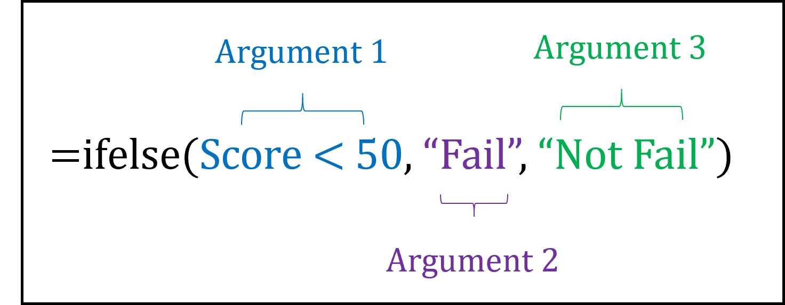



## About

For those of you who have yet to install R and RStudio, you can still complete the tasks using the document here. Note: this is not the same as having R and RStudio installed on your laptop, so you should make it a priority to install these before the next class.

## The Console

The Console is the beating heart of RStudio—it’s where R actually executes commands.

Try typing `2+2` or `5*5`, then press the **Run Code** button:

```{webr}

```

::: {.callout-important collapse = "true"}

### Check Code

```{webr}
2+2
```

```{webr}
5*5
```

:::

------------------------------------------------------------------------

## Installing packages

Installing a package is like downloading an app to your phone. You only need to do this once. On a smartphone, once you have downloaded Spotify, the app is stored on your device until you delete it.

Use the command `install.pckages("")` to install the `dplyr` and `ggplot2` packages:

```{webr}

```

::: {.callout-important collapse = "true"}

### Check Code

```{webr}
install.packages("dplyr")
install.packages("ggplot2")
```

:::

A useful point to emphasise is that “install” is about making the tool available on your computer, not about actually starting to use it. Installing Spotify doesn’t mean music starts playing, it just means the app is on your phone.

------------------------------------------------------------------------

## Loading packages

Now imagine you restart your phone. Even though Spotify is installed, it doesn’t automatically open itself every time the phone powers on. If you want to listen to music, you need to tap the Spotify icon. In R, this step is accomplished with the `library()` function:

```{webr}

```

This command tells R to load the package into the current session so its functions are available.

::: {.callout-important collapse = "true"}

### Check Code

```{webr}
library("dplyr")
library("ggplot2")
```

:::

------------------------------------------------------------------------

## Functions and Arguments

A `function` is a tool that takes `arguments`, applies rules, and gives back a result. For example, when we used Excel to write an `IF()` function:

<center>{width="50%"}</center>

<br>

-   The function is `IF()`
-   Argument 1 is the condition (here if cell A2 is less than 50)
-   Argument 2 is the result if the condition is TRUE (i.e. return the word "Fail")
-   Argument 3 is the result if the condition is FALSE (i.e. return the words "Not Fail")

Different functions will have different arguments. You cannot pass in arguments that the function does not expect, or leave out arguments that are required, because the function will not know what to do and will return an error. For example, if you tried to use the `SUM()` function in Excel, but passed in non numeric values as your arguments, you'll get an error (in this case, a "VALUE" error):

```{r, eval=FALSE}
=SUM(1, "Apple")
```

<small>  [1] #VALUE!</small>

<br>

Functions and arguments work the same in R (and other coding languages as well), although they may use different names. For example, suppose we assign (`<-`) the object `Score` with the number 45 (this gets stored in our environment):

```{webr}
Score <- 45
```

We can write a function a similar function to return "Fail" or "Not Fail" in R:

<center>{width="50%"}</center>

<br>

Try it for yourself:

```{webr}

```

::: {.callout-important collapse = "true"}

### Check Code

```{webr}
ifelse(Score < 50, "Fail", "Not Fail")
```

:::

***

## Named and unnamed arguments

Arguments can be provided in two ways:

### 1. unnamed arguments

Unnamed arguments rely on the **order** in which the function expects them. Using the `ifelse()` from above:

```{webr}
ifelse(Score < 50, "Fail", "Not Fail")
```

R understands that:

- the first argument is the condition (`Score < 50`)
- the second argument is what is returned when the condition is yes (`Fail`)
- the third argument is what is returned when the condition is no (`Not Fail`)

This works as long as you put the arguments in the correct order (condition, TRUE, FALSE). If you had placed the arguments in the wrong order, you will get the wrong output, or an error message, for example, try running the following:

```{webr}
ifelse("Fail", Score < 50, "Not Fail")
```

### 2. nammed arguments

Named arguments explicitly state which argument is which:

```{webr}
ifelse(
  test = Score < 50,
  yes = "Fail",
  no = "Not Fail"
)
```

Here, even if you change the order, R can still match them correctly because they are named:

```{webr}
ifelse(
  yes = "Fail",
  test = Score < 50,
  no = "Not Fail"
)
```

Using named arguments can make your code easier to read and reduce mistakes, especially when functions have many arguments. If you are using R/RStudio, you can click on F1 over any function and it will tell you what the arguments are.

***

## Entering Data

When working with R, most of the time you’ll import datasets from a file (for example, a CSV or Excel sheet). However, in the early stages of learning, it’s useful to practice by entering data manually. This helps you understand how R stores information and how to create your own data frames.

### 1. Creating vectors

The simplest way to enter this data is by creating vectors. A vector is an ordered list of values of the same type (all numbers, all characters, etc.). We can do this with the `c()` function, which stands for ‘combine.’

Create a vector for the following numbers: 20, 32.4, 40, 1.1, 26

```{webr}

```

::: {.callout-important collapse = "true"}

### Check Code

```{webr}
c(20, 32.4, 40, 1.1, 26)
```

:::

This is useful for a quick calculation, but if we wanted to save this vector (so that we can use it later) we will need to store it as an object. To do this, we need to assign it to a name using the assignment operator `<-`.

Assign the numbers below to an object called `income`:

```{webr}
c(20, 32.4, 40, 1.1, 26)
```

::: {.callout-important collapse = "true"}

### Check Code

```{webr}
ID <- c(1, 2, 3, 4, 5)
```

:::

Note that when you assign something a name and run the code, no output appears. This is because the object is now stored in your global environment (have a look at the global environment pane in the top-right). It will be stored there until we ‘call’ upon it. For example:

```{webr}

```

::: {.callout-important collapse = "true"}

### Check Code

```{webr}
income
```

:::

Let's create a second vector called `education` that has the following values: 14,14,16,13,13. After creating the vector, call it up to make sure it works.

```{webr}

```

::: {.callout-important collapse = "true"}

### Check Code

```{webr}
education <- c(14, 14, 16, 13, 13)
education
```

:::


***

## Creating a dataframe

A data frame is R’s way of storing tabular data, much like a spreadsheet. Each column is a vector (all of the same type: numeric, character, logical, etc.), and each row is an observation. In our example:

- The income vector is one column.
- The education vector is another column.
- Together, they make a two-column table.

We can combine our two vectors into a data frame using the `data.frame()` function (assuming you have created two objects and assigned them to your global environment as income and education.)

```{webr}

```

::: {.callout-important collapse = "true"}

### Check Code

```{webr}
data.frame(income, education)
```

:::

Note: in the example above, we did not assign our data frame with a name, so the output is printed directly into the console. Let’s now assign it a name so that we can use it in a meaningful way (call it `income_data`). Then call it up to make sure it works.

```{webr}

```

::: {.callout-important collapse = "true"}

### Check Code

```{webr}
income_data <- data.frame(income,education)
```

:::

***

## Inspecting a data frame

Now that we’ve created our first data frame, it’s important to learn how to look inside it. When working with larger datasets, it’s easy to lose track of what variables you have, how many rows are included, and what types of data each column contains.

R provides several functions for inspecting data, but one of the most versatile is `str()`, short for structure, which tells us:

- The number of observations (rows).
- The number of variables (columns).
- The names of the variables.
- The data type of each variable (numeric, character, factor, etc.).
- A preview of the first few values.

Use the `str()` function on our data frame.

```{webr}

```

::: {.callout-important collapse = "true"}

### Check Code

```{webr}
str(income_data)
```

:::

## The $ operator

We can use `$` after a stored object (such as a dataframe) to view the items in that object. For example, we can use the following code to view the values in our `income` vector of our dataframe.

```{webr}
income_data$income
```

***

## Applying functions to data frames

### Modern methods (using the pipe |> operator)

**Note**: Make sure you have the native pipe enabled:

- Tools
- Global options
- Code
- "Use native pipe"

The pipe operator allows us to read code from left to right, almost like a recipe: 

> “take this data, then apply this function.”

For example, let's write some code that:

1. Starts with our `income_data`, then
2. Select the `income` variable, then
3. Computes the `mean()`, then
4. rounds to the nearest whole number (i.e. 0 decimal places)

```{webr}

```

::: {.callout-important collapse = "true"}

### Check Code

```{webr}
income_data$income |> 
  mean() |>  
  round(0)
```

:::

### Using packages

Earlier, we loaded some packages (`dplyr` and `ggplot2`). The dplyr package contains some very useful functions that don't come with base R. In particular we can use the `summarise()` function with various base R functions to obtain different descriptive statistics.

For example, let's write some code that:

1. Starts with our `income_data`, then
2. using `summarise()`, compute the following for `income`:
  - the `mean()`
  - the `median()`
  - the `sd()`
  - the `min()`
  - the `max()`

```{webr}

```

::: {.callout-important collapse = "true"}

### Check Code

```{webr}
income_data |> 
  summarise(
    mean(income),
    median(income),
    sd(income),
    min(income),
    max(income)
  )
```

:::

***

## Creating new variables

The `mutate()` function can be used t0 create new variables derived from existing ones. Suppose our dataset stores income in thousands of dollars, but we want a new column showing income in actual dollars.

1. start with `income_data`, then
2. `mutate()` a new variable called `income_dollars` that multiplies `income` by 1000

```{webr}

```

::: {.callout-important collapse = "true"}

### Check Code

```{webr}
income_data |> 
  mutate(income_dollars = income * 1000)
```

:::

We can also create multiple new variables in the same `mutate()` call. For example, create two new variables:

1. income_dollars: income*1000
2. income_per_years: income/education

```{webr}

```

::: {.callout-important collapse = "true"}

### Check Code

```{webr}
income_data |> 
  mutate(
    income_dollars = income * 1000,
    income_per_years = income / education
  )
```

:::

## Combining mutate and summarise

One of the strengths of the pipe workflow is that you can apply several transformations in sequence, each building on the previous step. Let’s create two new variables with mutate(), then compute summary statistics with summarise().

1. Start with the `income_data` data frame, then
2. Create a new variable called `income_dollars` by taking income variable and multiply it by 1000, then
3. Create a new variable called `income_per_years` by taking the income_dollars variable and dividing by the education variable, then
4. Compute the mean and standard deviation for income_per_years

```{webr}

```

::: {.callout-important collapse = "true"}

### Check Code

```{webr}
income_data |> 
  mutate(income_dollars = income * 1000) |> 
  mutate(income_per_years = income_dollars / education) |> 
  summarise(
    mean(income_per_years),
    sd(income_per_years),
  )
```

:::

## Creating factors

Up to this point, we have worked with numeric data such as income and years of education. However, in many situations, data is categorical—representing groups, categories, or yes/no outcomes rather than continuous numbers. In R, categorical variables are stored as factors. Factors are useful because they carry not just the raw labels (e.g., “Yes”, “No”), but also information about the possible categories, known as levels.

Let’s imagine that, in addition to income and education, we collected two categorical variables for each of the same 5 participants:

- `Status`: “Employed” or “Unemployed”
- `Sex`: “Male” or “Female”

We can create these as factors and then attach them to our existing data frame, or to a new data frame.

```{webr}
#| caption: "Create two new factors"
Status <- c("Employed", "Employed", "Unemployed", "Unemployed", "Employed")
Sex <- c("Male", "Female", "Male", "Female", "Male")
```

```{webr}
#| caption: "Add the new variables to income_data and save it with a new name"
income_data2 <- income_data |> 
  mutate(
    Status = Status,
    Sex = Sex
  )
```

## Exploring Factors with table()

Now that our income_data dataset includes categorical variables (Status and Sex), we can explore how they relate to one another. One of the simplest and most useful tools for this is the table() function.

If we call `table()` on a single factor, R will show us the counts of each category. This tells us there are 2 females and 3 males in the dataset.

```{webr}

```

::: {.callout-important collapse = "true"}

### Check Code

```{webr}
table(income_data2$Sex)
```

:::

If we supply two factors, table() produces a contingency table: a cross-tabulation showing how the categories overlap.

```{webr}

```


::: {.callout-important collapse = "true"}

### Check Code

```{webr}
table(income_data2$Status, income_data2$Sex)
```

:::

## From Counts to Probabilities

The table() function gives raw counts, but we can easily convert them into relative frequencies (probabilities) using `prop.table()`.

```{webr}

```

::: {.callout-important collapse = "true"}

### Check Code

```{webr}
prop.table(table(income_data2$Status, income_data2$Sex))
```

:::

## Conditional Probabilities

We can also calculate conditional probabilities, for example, the probability of being employed given someone is male, by including the margin argument:

- margin = 1 → proportions within rows.
- margin = 2 → proportions within columns.

```{webr}

```

```{webr}

```

::: {.callout-important collapse = "true"}

### Check Code

```{webr}
prop.table(table(income_data2$Status, income_data2$Sex), margin = 1)
```

```{webr}
prop.table(table(income_data2$Status, income_data2$Sex), margin = 2)
```

:::

***

## Plots

In R, the most widely used package for data visualisation is ggplot2, which is part of the tidyverse. It implements the “grammar of graphics,” where plots are constructed by layering components: you start with a dataset, map variables to visual aesthetics such as axes or colours, and then add geometric layers (geoms) such as points, boxes, or bars.

```{r, eval=FALSE}
ggplot(data = <DATA>, mapping = aes(<AESTHETICS>)) +
  <GEOM_FUNCTION>() +
  <other layers>
```

Create the following plots:

1. a scatterplot (`geom_point`) for x = education and y = income
2. a boxplot (`geom_boxplot`) for x = Sex, y = income
3. a histogram (`geom_histogram`) for x = income

```{webr}

```

```{webr}

```

```{webr}

```

::: {.callout-important collapse = "true"}

### Check Code

```{webr}
ggplot(data = income_data2,
       aes(x = education, y = income)) +
  geom_point()
```

```{webr}
ggplot(data = income_data2,
       aes(x = Sex, y = income)) +
  geom_boxplot()
```

```{webr}
ggplot(data = income_data2,
       aes(x = income)) +
  geom_histogram()
```

:::

***

Here are more code chunks if needed:


```{webr}

```


```{webr}

```


```{webr}

```


```{webr}

```


```{webr}

```


```{webr}

```


```{webr}

```


```{webr}

```


```{webr}

```


```{webr}

```


